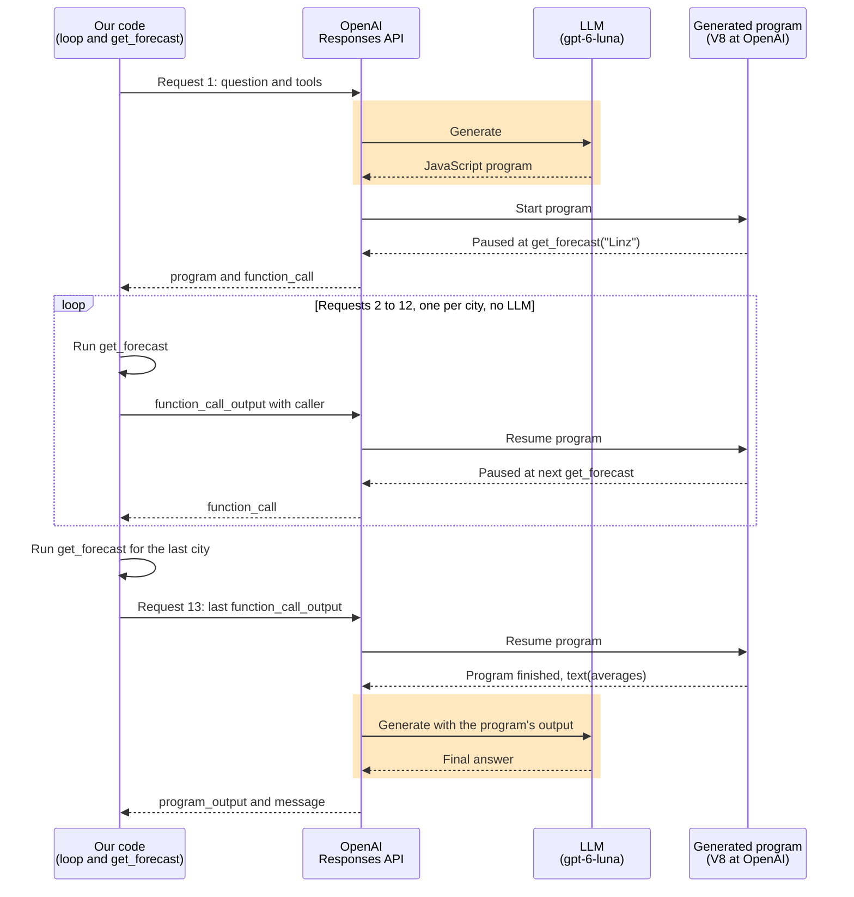

# Session 1 storybook: function calling APIs

**Classroom: Moderne KI-Agents entwickeln, session 1, second part**

This storybook walks you through the sample code for the part of session 1 that follows the function calling fundamentals. You run each sample, read it, and stop it in the debugger where something interesting happens. Each step has a **Goal**, the command to **Run**, a **Walkthrough** of the code, the breakpoints to set under **Debug**, and a **Verify** checklist. Some steps add a **Try it** experiment. Step numbers continue from the fundamentals part, and the code sits in one numbered folder per step, next to this file.

## The idea of this part

The fundamentals part followed one function call down to the text a model writes. This part comes back up to the code you write every day. Step 6 runs the same function calling loop through three APIs. Step 7 uses a schema to make the model's answer usable by a program instead of a person, and puts a decision model next to the LLM. Step 8 lets the model write code that calls your tools.

## Prerequisites

You need Node.js 24 or newer, Visual Studio Code, and the `.env` file in the repository root with `OPENROUTER_API_KEY`. Install the packages in this folder:

```bash
npm install
```

**OpenAI instead of OpenRouter.** Every file that can run with an OpenAI key has a commented-out OpenAI variant next to the OpenRouter lines, and all of them work against the OpenAI API with `gpt-5.4-mini`. In step 6, switch `MODEL` in `shared.ts`, then the client in `openai.ts` or the `model` line in the Mastra files. `06:anthropic` needs OpenRouter or an Anthropic key, so with only an OpenAI key you follow that one on the trainer's screen. In step 7, the Jev parts still use OpenRouter, and `07:compare` prints `n/a` for the LLM cost, because only OpenRouter reports it.

Step 8 is the exception in the other direction. It needs `OPENAI_API_KEY` in `.env`, because OpenRouter removes the `allowed_callers` field from the request before it reaches OpenAI.

## Debugging the samples

Open the repository root as the folder in Visual Studio Code, because the launch configuration reads `.env` from there. Open a sample file, set the breakpoints for the step, pick **Debug current sample file** in the Run and Debug view, and press F5. **Debug current sample file with argument** asks for one command-line argument first.

Every place worth stopping at carries a marker comment such as `// Breakpoint 6.2: the history this step sends.` Set the breakpoint on the first code line below the marker. A search for `Breakpoint 6.` finds all markers of step 6. When a marker names a condition, right-click the gutter, choose **Add Conditional Breakpoint**, and type the condition.

The fundamentals storybook explains the Variables, Watch, Debug Console, and Call Stack panes. In this part the Call Stack matters most, because it shows which code runs your tool: your own loop or a framework's.

## Step 6: one loop, three APIs

**Goal.** Run the same question through the OpenAI SDK, the Anthropic SDK, and Mastra, with the same model behind all three. You see which differences are only field names and what a framework takes off your hands.

**Run.**

```bash
npm run 06:openai
```

```
Step 1: finish_reason = tool_calls
  get_weather({"city": "Linz"}) -> {"city":"Linz","temperature":7,"condition":"fog"}
  get_weather({"city": "Graz"}) -> {"city":"Graz","temperature":11,"condition":"sun"}
Step 2: finish_reason = stop
Final answer: Graz is warmer right now at 11°C and sunny, while Linz is 7°C and foggy.
```

```bash
npm run 06:anthropic
```

```
Step 1: stop_reason = tool_use
  get_weather({"city":"Linz"}) -> {"city":"Linz","temperature":7,"condition":"fog"}
  get_weather({"city":"Graz"}) -> {"city":"Graz","temperature":11,"condition":"sun"}
Step 2: stop_reason = end_turn
Final answer: Graz is warmer right now at 11°C with sunshine, while Linz is at 7°C with fog.
```

```bash
npm run 06:mastra
```

```
Step 1: finishReason = tool-calls
  get_weather({"city":"Linz"}) -> {"city":"Linz","temperature":7,"condition":"fog"}
  get_weather({"city":"Graz"}) -> {"city":"Graz","temperature":11,"condition":"sun"}
Step 2: finishReason = stop
Final answer: Graz is warmer right now at 11 degrees with sunshine, while Linz is 7 degrees and foggy.
```

The wording of the final answer changes between runs, and so does the spacing inside the arguments string.

**Walkthrough.** Start with `06-three-apis/shared.ts`. The model, the question, the step limit, and `getWeather` live there, so the three scripts differ only in the API code around them.

Read `06-three-apis/openai.ts` next. It's the loop from step 1, now inside a `for` loop with a step limit. Then open `06-three-apis/anthropic.ts` side by side. Its comments point out every place where the Messages API differs from Chat Completions. Finish with `06-three-apis/mastra.ts`.

| | OpenAI Chat Completions | Anthropic Messages | Mastra |
|---|---|---|---|
| Tool parameters | `function.parameters`, JSON schema | `input_schema`, JSON schema | `inputSchema`, Zod |
| System prompt | First entry in `messages` | Top-level `system` | `instructions` on the agent |
| Output limit | Optional | `max_tokens` is required | Optional |
| Signal to keep going | `finish_reason: "tool_calls"` | `stop_reason: "tool_use"` | Handled inside `generate` |
| Where the calls are | `message.tool_calls[]` | `tool_use` blocks in `content` | `execute` runs for you |
| Arguments | JSON string, you parse it | Object in `input` | Object, checked against the schema |
| Tool results | One `tool` message per call | One `user` message with one `tool_result` block per call | Mastra sends them |
| Agent loop | Your `for` loop | Your `for` loop | `maxSteps`, default 5 |

- The model asks for both cities in one step. These are parallel tool calls, and they're where the two formats differ most: Chat Completions wants one `tool` message per call, while Messages wants all `tool_result` blocks in a single `user` message.
- `tool_call_id` and `tool_use_id` link each result to its call. With two calls in one step, the model needs them to know which temperature belongs to which city.
- A Claude model answers on the Chat Completions path too, because OpenRouter translates the request. That's the API layer from the fundamentals part at work.
- `mastra.ts` has no loop at all, just one `agent.generate` call. The loop still runs, and `response.steps` proves it with the same two steps. Mastra also runs your `execute` function and checks the arguments against the Zod schema.
- Write the loop by hand once, then use a framework. You need the hand-written version in your head when a framework's agent does something you didn't expect.
- Always set a step limit. A model can keep asking for tools, and each step costs money. `MAX_STEPS` in the SDK scripts and `maxSteps` in Mastra are the same safety net.

**Debug.** Breakpoint 6.1 sits in `getWeather` in `shared.ts`, so it stops in all three scripts. Set it once and keep it while you debug each script in turn.

- **Breakpoint 6.1, who runs the tool.** Debug `openai.ts` and look at the Call Stack: `getWeather`, then the top level of `openai.ts`. Your loop called the tool. Do the same with `mastra.ts`. Below `getWeather` you find your own `execute` function, and below that a long list of frames from `node_modules/@mastra/core`. The top level of `mastra.ts` is so far down that the Call Stack pane may cut it off. Those Mastra frames are the loop you wrote by hand in `openai.ts`. Click a few of them to see Mastra's code.
- **Breakpoint 6.2, the history this step sends.** In `openai.ts`, add `messages.length` to Watch. It's 2 on the first stop and 5 on the second: system, user, the assistant message with two tool calls, and two `tool` messages.
- **Breakpoint 6.3, two tool calls in one message.** Expand `message.tool_calls`. Two entries, each with its own `id`, and each `arguments` is a JSON string.
- **Breakpoint 6.4, the content blocks.** In `anthropic.ts`, expand `response.content`. The calls are `tool_use` blocks in the same array as any text, and `input` is already an object.
- **Breakpoint 6.5, one user message for all results.** Expand `results`. Both `tool_result` blocks go into one `user` message, and `tool_use_id` matches the `id` of the block from 6.4.
- **Breakpoint 6.6, the loop Mastra ran.** In `mastra.ts`, expand `response.steps`. Two entries, each with the tool calls and tool results that your `for` loop collected by hand in the SDK scripts.

**Outlook: an agent as a tool.** This only opens the perspective for session 5, which covers multi-agent systems. So far every tool was a plain function, and a tool can also be another agent with its own loop.

```bash
npm run 06:subagent
```

```
  Inside the subagent: get_weather({"city":"Linz"}) -> {"city":"Linz","temperature":7,"condition":"fog"}
  Inside the subagent: get_weather({"city":"Graz"}) -> {"city":"Graz","temperature":11,"condition":"sun"}
Step 1: finishReason = tool-calls
  agent-weather({"prompt":"What is the current temperature in Linz and in Graz? Please give the temperature for each city."}) -> Graz is warmer right now at 11 degrees with sunny skies, while Linz is 7 degrees and foggy.
Step 2: finishReason = stop
Final answer: Graz is warmer right now at 11°C with sunny skies, while Linz is cooler at 7°C and foggy.
```

The supervisor rewrites the prompt on every run and sometimes writes "Linz, Austria" as the city.

- Find the line `agents: { weather: weatherAgent }` in `06-three-apis/mastra-subagent.ts`. Mastra turns it into a tool called `agent-weather`, and the subagent's `description` becomes the tool description. The supervisor's model writes an ordinary function call with a `prompt` argument, so the thesis of the fundamentals part still holds.
- The SDK scripts could do the same with a tool function that runs a second loop. In Mastra it's one configuration line.
- The `get_weather` lines come first because the whole inner loop runs inside step 1 of the supervisor.
- The supervisor's model gets only the subagent's final text as the tool result, and the two `get_weather` results stay out of its context. In the other direction Mastra forwards more than the `prompt`: the subagent's request also holds the supervisor's system prompt and the user's original question. `delegation.messageFilter` controls that, and session 5 picks it up.
- A subagent around one tool adds nothing here. It needs four model requests where `06:mastra` needs two. Delegation pays off when a subagent needs many tool calls or large results that shouldn't fill the supervisor's context. When to split agents is the topic of session 5.

Debug `mastra-subagent.ts` with breakpoints 6.1 and 6.7.

- **Breakpoint 6.1 again.** The Call Stack shows Mastra frames, as in `mastra.ts`. Nothing has printed yet, because the supervisor's step 1 is still running: its tool call is the subagent's whole loop. That's why the `Inside the subagent` lines come before `Step 1` in the output.
- **Breakpoint 6.7, what the supervisor got back.** Expand `payload.result`. Next to `text` you find `subAgentToolResults`, which holds both weather results. Those are there for your code. Only `text` goes back to the supervisor's model as the tool result.

**Verify.**

- [ ] Each of the three scripts prints two steps and two `get_weather` calls.
- [ ] Each final answer says Graz is warmer, with 11 and 7 degrees.
- [ ] The first step ends with the signal to keep going, and the second step ends with the signal to stop.
- [ ] `06:subagent` shows `agent-weather` as the supervisor's only tool, with the `get_weather` calls on their own "Inside the subagent" lines.

## Step 7: structured input and output for an agentic UI

**Goal.** Look at the core of an agentic UI: the user types free text, and the model returns the new content of a form. The form is fictional and only exists in the terminal, because the interesting part is the contract between the UI and the model.

**Run.**

```bash
npm run 07:form
```

The script first prints the JSON schema, then processes four scripted inputs. The second one is the interesting one, because it needs the form from the first:

```
=== User types: Make that one day longer. My budget is 400 euros. ===

Jev (191 ms): fill_form, confidence 0.96, {"fill_form":0.97,"question":0.02,"unrelated":0.01}
Model text: {"form":{"destination":"Vienna","departureDate":"2026-11-17","returnDate":"2026-11-20","transport":"train","hotelNeeded":true,"budgetEuros":400},"reply":"I extended the trip by one day and set the budget to 400 euros."}
LLM (1056 ms)
Changed field: returnDate: "2026-11-19" -> "2026-11-20"
Changed field: budgetEuros: null -> 400
Reply: I extended the trip by one day and set the budget to 400 euros.
```

The third input asks for a helicopter, which the form doesn't offer. The script prints `Changed fields: none`, and the reply tells the user why. The fourth input never reaches the LLM:

```
=== User types: What's a good recipe for apple strudel? ===

Jev (185 ms): unrelated, confidence 1, {"fill_form":0,"question":0,"unrelated":1}
No LLM call. The UI shows a fixed hint.
```

Then give both models the same categorization job:

```bash
npm run 07:compare
```

```
"Could I take a helicopter instead?"
  Jev   240 ms: question, confidence 0.74, {"fill_form":0.16,"question":0.83,"unrelated":0.01}
  LLM  1625 ms: question, says confidence 0.98

"Vienna"
  Jev   208 ms: fill_form, confidence 0.62, {"fill_form":0.75,"question":0.02,"unrelated":0.23}
  LLM  1281 ms: fill_form, says confidence 0.95

"Ugh, this trip is getting expensive."
  Jev   220 ms: unrelated, confidence 0.61, {"fill_form":0.19,"question":0.07,"unrelated":0.74}
  LLM   814 ms: question, says confidence 0.55

Jev total: 1418 ms, $0.000090
LLM total: 7181 ms, $0.001054
```

| | TypeSafe Jev | LLM with structured output |
|---|---|---|
| Answer | A value from the options you define | Any text or JSON that fits your schema |
| New values, such as a date or a reply | Can't produce them | Writes them |
| Tool calls | None | Yes |
| Probabilities | One per option, in every `choice` answer | Only a number the model writes if you ask for one |
| Six categorizations in `07:compare` | About 1.4 seconds, $0.00009 | About 7 to 8 seconds, $0.00105 with `gpt-5.4-mini` |

**Walkthrough.** Open `07-structured-form/main.ts` and start at the `user` message inside `updateForm`.

- The current form goes in as JSON next to the free text, and that's the structured input.
- The script sends no chat history. "One day longer" works because the return date is in the form the UI sends along, so the form is the conversation's state.
- `response_format` with `strict: true` is the structured output. The `Model text` line shows that the answer is still text the model wrote, and the API constrains which text is allowed. The script parses and validates it anyway.
- `TripForm` describes the data in both directions. `z.toJSONSchema` turns it into the schema for the API, `z.infer` turns it into the TypeScript type, and `AgentResponse.parse` checks the answer.
- `transport` is an enum, so "helicopter" can't get into that field. The `reply` field gives the model a place to tell the user what it couldn't do. Without that field, the model has only the form to answer with.
- Strict mode forces every field into `required`, so optional form fields are `.nullable()` and never `.optional()`.
- Today's date is in the system prompt because the model doesn't know it. `next Tuesday` only resolves to `2026-11-17` because your code said what today is. The script uses a fixed date so the output stays reproducible.
- The schema guarantees the shape and says nothing about the meaning. The model reads "next Tuesday for two days" as Tuesday to Thursday, and someone else would read it as Tuesday to Wednesday. A rule like "return after departure" doesn't fit into this schema either, so it stays in your code.
- The sample returns the complete form, which is simple to apply, and the UI can compute the difference itself. A model could still change a field nobody mentioned, so show the changes to the user before saving. For large forms, switch to a list of field changes to keep the output small.

Use a function tool when the result goes back to the model, as in step 6. Use structured output when the result goes to your program, as in this step. The form update is the end of the turn, so nothing has to go back.

Now the decision model. Open `07-structured-form/jev.ts`.

- Jev is a System One model, which TypeSafe defines as a model for fast, typed decisions. You send a `state` and typed questions to `/api/v1/systemone`, and that request has no `messages` and no `tools`. The question types are `choice`, `score`, and `noul` (a probability that a statement is true).
- Jev can't fill in this form, because it can't write `2026-11-17` or a reply. It only picks from what you listed. So the two models split the work: Jev decides what kind of input this is, and the LLM writes the new form.
- `UNRELATED_THRESHOLD` in `main.ts` shows why probabilities matter. The script skips the LLM only if Jev says `unrelated` with a confidence of at least 0.8, so "Ugh, this trip is getting expensive." would still reach the LLM.
- Jev's `confidence` isn't the probability of the winning option. For "Vienna", `fill_form` has a probability of 0.75 and a confidence of 0.62. `UNRELATED_THRESHOLD` checks the confidence, and TypeSafe's docs describe how the two numbers differ.
- Compare the confidence columns for "Vienna". Jev says 0.62, and the LLM says it's at least 95 percent sure. Six rows can't prove which number is well calibrated, and TypeSafe's docs say calibration only holds across groups of predictions. Branch on Jev's number after checking it on your own data, and never branch on a confidence an LLM wrote into its JSON without measuring it first.
- Jev's answer can still be wrong or debatable. Is complaining about the price really `unrelated`? That's a modeling question about your categories, and better criteria text is the fix.

If data can't go to a hosted API, open-weight models trained to imitate Jev exist, such as `autotrust/JEV-9B` on Hugging Face.

**Debug.** Set breakpoints 7.1 to 7.3 and debug `main.ts`.

- **Breakpoint 7.2, Jev's answer.** This one stops first, inside `categorize`. Expand `data.answers.category`: `choice`, `confidence`, and one probability per category. `data.usage.cost` is the price of this one decision.
- **Breakpoint 7.3, the branch.** This one stops next, before `updateForm` runs. For now, continue with F5.
- **Breakpoint 7.1, the structured output.** Hover over `text`. It's a plain string, even with `strict: true`. Expand `response.choices[0].message` too: there's no `tool_calls`, because structured output is the answer itself.

Continue until breakpoint 7.3 stops on the apple strudel question. In Variables, change `answer.confidence` to `0.5` and continue. The LLM now gets the question. The system prompt tells it to leave the form alone for requests that don't fit, so watch whether it does, and what it writes in the reply.

**Try it.** Run your own sentence through the form:

```bash
npm run 07:form -- "Send me to Paris by plane on December 1st"
```

```
Changed field: destination: null -> "Paris"
Changed field: departureDate: null -> "2026-12-01"
Changed field: transport: null -> "plane"
```

Then change `budgetEuros` in `TripForm` to `.optional()` and debug again with **Caught Exceptions** turned on in the Breakpoints pane. **Uncaught Exceptions** doesn't stop here, because the error leaves through a top-level `await`. The request fails with HTTP 400, and the debugger stops inside the OpenAI SDK, possibly more than once for the same error. Expand the exception in Variables and look for `error.metadata.raw`. It's a JSON string, and the `message` inside it ends with `Missing 'budgetEuros'.` Change it back to `.nullable()` afterwards.

**Verify.**

- [ ] The first input fills destination, both dates, transport, and hotel.
- [ ] The second input changes only `returnDate` and `budgetEuros`.
- [ ] The third input prints `Changed fields: none`.
- [ ] The fourth input prints `No LLM call.`, and the final form has `"transport": "train"`.
- [ ] `07:compare` prints a Jev and an LLM line for all six inputs.

## Step 8: programmatic tool calling

**Goal.** Let the model write a small program that calls your tools in a loop, and compare that with direct tool calls on a task with a lot of data.

**Run.**

```bash
npm run 08:ptc
```

A run looks like this:

```text
########## direct ##########

Final answer: Wels has the highest average temperature: **7.70 °C**.
Correct answer: Wels, 7.70
Requests: 2, tool calls: 12, input tokens: 1780, output tokens: 1060

########## programmatic ##########

Program the model wrote:

const cities = ["Linz", "Graz", "Wien", "Salzburg", "Innsbruck", "Klagenfurt", "Villach", "Wels", "Steyr", "Dornbirn", "Bregenz", "Eisenstadt"];
const results = [];
for (const city of cities) results.push(await tools.get_forecast({city}));
const averages = results.map(r => ({city:r.city, average:r.hourly.reduce((a,b)=>a+b,0)/r.hourly.length}));
averages.sort((a,b)=>b.average-a.average);
text(JSON.stringify(averages));


Program status: completed
Final answer: Wels has the highest average temperature over the next 24 hours: **7.70 °C**.
Correct answer: Wels, 7.70
Requests: 13, tool calls: 12, input tokens: 1586, output tokens: 164
```

Six runs side by side:

| | Direct | Programmatic |
|---|---|---|
| Requests | 2 | 13 |
| Tool calls | 12 | 12 |
| Input tokens | 1780 | 1416 to 1596 |
| Output tokens | 723 to 1060 | 137 to 173 |
| Correct answer | 5 of 6 | 6 of 6 |

**Walkthrough.** Open `08-programmatic-tool-calling/main.ts` and start at `buildTools`. In `programmatic` mode, `get_forecast` gets `allowed_callers` and an `output_schema`, and a second tool, `programmatic_tool_calling`, joins the list. Then read `run`, which is the agent loop with the Responses API.

This diagram shows how the requests from your code, the LLM, and the generated program work together:



The orange blocks are the only places where the LLM works. The arrows inside OpenAI are an interpretation of the behavior: OpenAI documents that the runtime resumes the program, and requests 2 to 12 report 0 tokens.

- In step 6 every tool result went through the model's context. Here the model writes JavaScript once, and the 288 forecast values stay in the program.
- Output tokens drop to about a sixth, because the model writes a short program and doesn't work through the sums itself. Input tokens barely move at this data size.
- The price is round trips. When the model writes a `for` loop with `await`, the program pauses 12 times and each result goes back in its own request.
- `get_forecast` still runs in your process. OpenAI runs the generated program in a fresh V8 runtime with no network, no Node.js, and no file system, and each tool call pauses the program until your code answers.
- The response has three new item types to know: `program` with the code, `function_call` with a `caller` that names the program, and `program_output` with the result.
- Send `caller` back with each `function_call_output`, and send the `program` items back as well. With `store: false`, the service has no other way to resume the right program.
- `output_schema` tells the model what a tool returns before it has seen a single result. Without it, the generated code has to guess the field names.
- Averaging 288 numbers is arithmetic, and code is better at it than a model. In direct mode the model has to do that sum in its reasoning, so compare its answer with the `Correct answer` line. Direct mode is usually right on this data, and a single run proves nothing either way.
- Use direct calls when each result may change the next decision or an action needs approval. OpenAI's deployment checklist says the same.

OpenAI isn't the only provider with this feature. The Anthropic API has it too, with the `code_execution_20260120` tool and `allowed_callers` on your custom tool, and Claude runs the code in Anthropic's sandbox. Not every model accepts it: `gpt-5.4-mini` answers with `Tool 'programmatic_tool_calling' is not supported`, so this sample uses `gpt-6-luna`.

**Debug.** Use **Debug current sample file with argument** with the argument `programmatic`, so only that mode runs. The loop runs 13 times, so add `step` and `response.usage` to Watch.

- **Breakpoint 8.1, output item types and usage.** If you debug both modes, make this a conditional breakpoint with `mode === "programmatic"`. On the first stop, run `response.output.map((item) => item.type)` in the Debug Console. You see `program` and `function_call`. Expand the `program` item and read `code`. Continue a few times and watch `response.usage`: the requests between the first and the last don't run the LLM. On the last stop, the item types include `program_output` and `message`.
- **Breakpoint 8.2, the caller.** Expand `call.caller`. It names the program that's paused at this `get_forecast` call, and it goes back with the result in `function_call_output`. In `direct` mode, `call.caller` is missing.

This is the one step where a pause in the debugger isn't free. The generated program waits at OpenAI while you're paused, and the sample doesn't test how long OpenAI keeps it. If a long pause ends in an error, run it again.

**Verify.**

- [ ] The `programmatic` section prints a `Program the model wrote:` block.
- [ ] The `programmatic` section prints a final answer that matches the `Correct answer` line.
- [ ] Both sections end with a line of requests, tool calls, and tokens.

## What you have now

You have the same function calling loop in three APIs, a form that a model fills in from free text with a decision model in front of it, and a model that writes its own tool-calling code. `06-three-apis/mastra.ts` and `06-three-apis/mastra-subagent.ts` are the starting points for the Mastra agents later in the course, and `TripForm` in `07-structured-form/main.ts` is a pattern you can copy for your own UI state.
