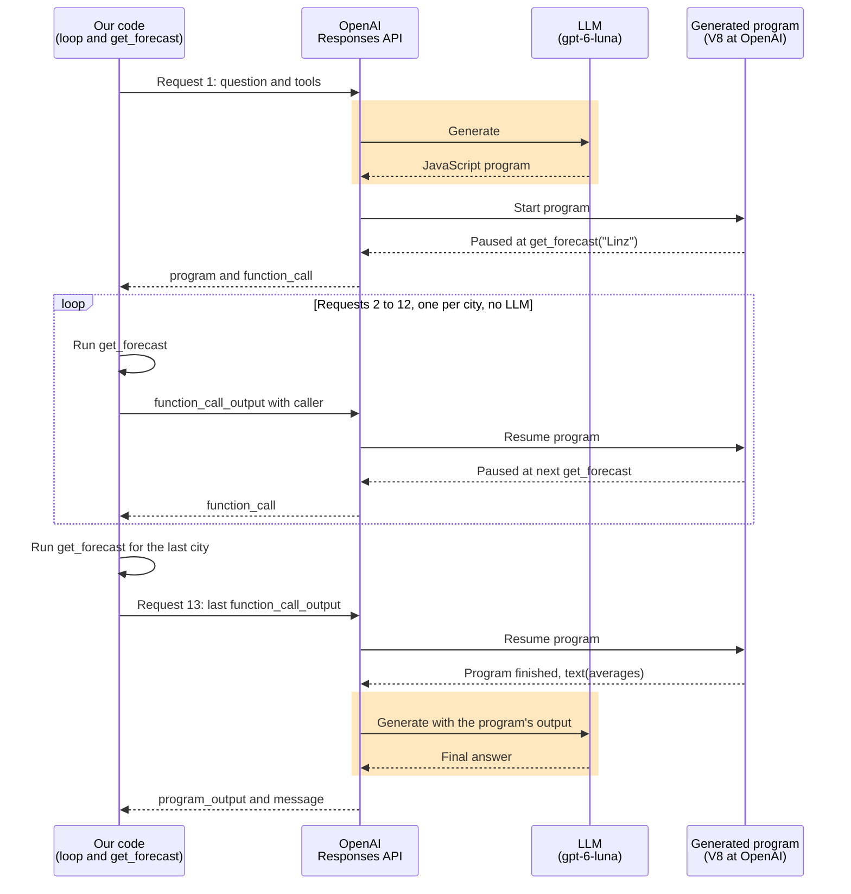

# Session 1 storybook: function calling APIs

**Classroom: Moderne KI-Agents entwickeln, session 1, second part**

This is the live-demo script for the part of session 1 that follows the function calling fundamentals. Each step has a **Goal**, the **Prompt** for your coding agent if you'd rather build the demo live, the command to **Run**, **Teaching points** to narrate, and a **Verify** checklist. Step numbers continue from the fundamentals part, and the finished code sits in one numbered folder per step, next to this file.

## The idea of this part

The fundamentals part followed one function call down to the text a model writes. This part comes back up to the code participants write every day. Step 6 runs the same function calling loop through three APIs. Step 7 uses a schema to make the model's answer usable by a program instead of a person, and puts a decision model next to the LLM. Step 8 lets the model write code that calls your tools.

## Prerequisites

You need Node.js 24 or newer and the `.env` file in the repository root with `OPENROUTER_API_KEY`. Install the packages in this folder:

```bash
npm install
```

**Participants.** Step 7 and `06:openai` use the standard Chat Completions API, so they should work with an OpenAI key after changing the base URL and the model name. `06:mastra` and `06:subagent` read `OPENAI_API_KEY` if you change their model strings to an `openai/...` model. Both paths are untested. `06:anthropic` needs OpenRouter or an Anthropic key, so participants with only an OpenAI key watch that one on your screen. The Jev parts of step 7 use OpenRouter or a TypeSafe key.

Step 8 is the exception in the other direction. It needs `OPENAI_API_KEY` in `.env`, because OpenRouter removes the `allowed_callers` field from the request before it reaches OpenAI.

## Step 6: one loop, three APIs

**Goal.** Run the same question through the OpenAI SDK, the Anthropic SDK, and Mastra, with the same model behind all three. Participants see which differences are only field names and what a framework takes off your hands.

**Prompt.**

> Create three small TypeScript scripts that answer "Is it warmer in Linz or in Graz right now?" with a get_weather tool, all against OpenRouter with anthropic/claude-haiku-5.5. One uses the OpenAI SDK with Chat Completions, one uses the Anthropic SDK with the Messages API, and one uses a Mastra agent. The two SDK scripts each contain their own agent loop with a step limit. Share the model name, the question, and the tool function in one file. All three print the steps in the same format.

**Run.**

```bash
npm run 06:openai
```

```
Step 1: finish_reason = tool_calls
  get_weather({"city": "Linz"}) -> {"city":"Linz","temperature":7,"condition":"fog"}
  get_weather({"city": "Graz"}) -> {"city":"Graz","temperature":11,"condition":"sun"}
Step 2: finish_reason = stop
Final answer: Graz is warmer right now at 11°C and sunny, while Linz is 7°C and foggy.
```

```bash
npm run 06:anthropic
```

```
Step 1: stop_reason = tool_use
  get_weather({"city":"Linz"}) -> {"city":"Linz","temperature":7,"condition":"fog"}
  get_weather({"city":"Graz"}) -> {"city":"Graz","temperature":11,"condition":"sun"}
Step 2: stop_reason = end_turn
Final answer: Graz is warmer right now at 11°C with sunshine, while Linz is at 7°C with fog.
```

```bash
npm run 06:mastra
```

```
Step 1: finishReason = tool-calls
  get_weather({"city":"Linz"}) -> {"city":"Linz","temperature":7,"condition":"fog"}
  get_weather({"city":"Graz"}) -> {"city":"Graz","temperature":11,"condition":"sun"}
Step 2: finishReason = stop
Final answer: Graz is warmer right now at 11 degrees with sunshine, while Linz is 7 degrees and foggy.
```

Open `06-three-apis/openai.ts` and `06-three-apis/anthropic.ts` side by side, then `06-three-apis/mastra.ts`.

| | OpenAI Chat Completions | Anthropic Messages | Mastra |
|---|---|---|---|
| Tool parameters | `function.parameters`, JSON schema | `input_schema`, JSON schema | `inputSchema`, Zod |
| System prompt | First entry in `messages` | Top-level `system` | `instructions` on the agent |
| Output limit | Optional | `max_tokens` is required | Optional |
| Signal to keep going | `finish_reason: "tool_calls"` | `stop_reason: "tool_use"` | Handled inside `generate` |
| Where the calls are | `message.tool_calls[]` | `tool_use` blocks in `content` | `execute` runs for you |
| Arguments | JSON string, you parse it | Object in `input` | Object, checked against the schema |
| Tool results | One `tool` message per call | One `user` message with one `tool_result` block per call | Mastra sends them |
| Agent loop | Your `for` loop | Your `for` loop | `maxSteps`, default 5 |

**Teaching points.**

- The model asks for both cities in one step. These are parallel tool calls, and they're where the two formats differ most: Chat Completions wants one `tool` message per call, while Messages wants all `tool_result` blocks in a single `user` message.
- `tool_call_id` and `tool_use_id` link each result to its call. With two calls in one step, the model needs them to know which temperature belongs to which city.
- All three scripts use the same model, so the API format is the only thing that changes between them.
- A Claude model answers on the Chat Completions path too, because OpenRouter translates the request. That's the API layer from the fundamentals part at work.
- Put your finger on the `for` loop in the two SDK files, then show the single `agent.generate` line in Mastra. The loop still runs, and `response.steps` proves it with the same two steps. Mastra also runs your `execute` function and checks the arguments against the Zod schema.
- Write the loop by hand once, then use a framework. You need the hand-written version in your head when a framework's agent does something you didn't expect.
- Always set a step limit. A model can keep asking for tools, and each step costs money. `MAX_STEPS` in the SDK scripts and `maxSteps` in Mastra are the same safety net.

The wording of the final answer changes between runs, and so does the spacing inside the arguments string.

**Outlook: an agent as a tool.** Plan two or three minutes for this. It only opens the perspective for session 5, which covers multi-agent systems. So far every tool was a plain function, and a tool can also be another agent with its own loop.

> Add a fourth script that answers the same question with a Mastra supervisor agent. The supervisor has no tools of its own and gets a weather agent through the agents option. The weather agent owns get_weather and prints each call. Print the supervisor's steps in the same format as before.

```bash
npm run 06:subagent
```

```
  Inside the subagent: get_weather({"city":"Linz"}) -> {"city":"Linz","temperature":7,"condition":"fog"}
  Inside the subagent: get_weather({"city":"Graz"}) -> {"city":"Graz","temperature":11,"condition":"sun"}
Step 1: finishReason = tool-calls
  agent-weather({"prompt":"What is the current temperature in Linz and in Graz? Please give the temperature for each city."}) -> Graz is warmer right now at 11 degrees with sunny skies, while Linz is 7 degrees and foggy.
Step 2: finishReason = stop
Final answer: Graz is warmer right now at 11°C with sunny skies, while Linz is cooler at 7°C and foggy.
```

The supervisor rewrites the prompt on every run and sometimes writes "Linz, Austria" as the city.

- Show the line `agents: { weather: weatherAgent }` in `06-three-apis/mastra-subagent.ts`. Mastra turns it into a tool called `agent-weather`, and the subagent's `description` becomes the tool description. The supervisor's model writes an ordinary function call with a `prompt` argument, so the thesis of the fundamentals part still holds.
- This is the perspective on frameworks. The SDK scripts could do the same with a tool function that runs a second loop. In Mastra it's one configuration line.
- The `get_weather` lines come first because the whole inner loop runs inside step 1 of the supervisor.
- We logged the HTTP requests of one run. The supervisor's model got only the subagent's final text as the tool result, and the two `get_weather` results stayed out of its context. In the other direction Mastra forwards more than the `prompt`: the subagent's request also held the supervisor's system prompt and the user's original question. `delegation.messageFilter` controls that, and session 5 picks it up.
- Say openly that a subagent around one tool adds nothing here. That run needed four model requests where `06:mastra` needs two. Delegation pays off when a subagent needs many tool calls or large results that shouldn't fill the supervisor's context. When to split agents is the topic of session 5.

**Verify.**

- [ ] Each of the three scripts prints two steps and two `get_weather` calls.
- [ ] Each final answer says Graz is warmer, with 11 and 7 degrees.
- [ ] The first step ends with the signal to keep going, and the second step ends with the signal to stop.
- [ ] `06:subagent` shows `agent-weather` as the supervisor's only tool, with the `get_weather` calls on their own "Inside the subagent" lines.

## Step 7: structured input and output for an agentic UI

**Goal.** Build the core of an agentic UI: the user types free text, and the model returns the new content of a form. The form is fictional and only exists in the terminal, because the interesting part is the contract between the UI and the model.

**Prompt.**

> Write a TypeScript script for a fictional business trip request form with destination, departure date, return date, transport (train, car, or plane), hotel needed, and budget. Define the form once as a Zod schema. For each user input, send the current form as JSON together with the user's text to openai/gpt-5.4-mini via OpenRouter with a strict json_schema response_format, and get back the complete new form and a short reply for the user. Print the raw model text and the changed fields. Use the OpenAI SDK without its parse helpers, so the response_format is visible. Before each LLM call, categorize the input with TypeSafe Jev through OpenRouter's /api/v1/systemone endpoint, and skip the LLM if Jev is confident the input is unrelated. Check the TypeSafe docs for the request format.

**Run.**

```bash
npm run 07:form
```

The script first prints the JSON schema, then processes four scripted inputs. Stop at the second input, because that's the one that needs the form.

```
=== User types: Make that one day longer. My budget is 400 euros. ===

Jev (191 ms): fill_form, confidence 0.96, {"fill_form":0.97,"question":0.02,"unrelated":0.01}
Model text: {"form":{"destination":"Vienna","departureDate":"2026-11-17","returnDate":"2026-11-20","transport":"train","hotelNeeded":true,"budgetEuros":400},"reply":"I extended the trip by one day and set the budget to 400 euros."}
LLM (1056 ms)
Changed field: returnDate: "2026-11-19" -> "2026-11-20"
Changed field: budgetEuros: null -> 400
Reply: I extended the trip by one day and set the budget to 400 euros.
```

The third input asks for a helicopter, which the form doesn't offer. The script prints `Changed fields: none`, and the reply tells the user why. The fourth input never reaches the LLM:

```
=== User types: What's a good recipe for apple strudel? ===

Jev (185 ms): unrelated, confidence 1, {"fill_form":0,"question":0,"unrelated":1}
No LLM call. The UI shows a fixed hint.
```

Let participants suggest a sentence and run it:

```bash
npm run 07:form -- "Send me to Paris by plane on December 1st"
```

```
Changed field: destination: null -> "Paris"
Changed field: departureDate: null -> "2026-12-01"
Changed field: transport: null -> "plane"
```

Then give both models the same categorization job:

```bash
npm run 07:compare
```

```
"Could I take a helicopter instead?"
  Jev   240 ms: question, confidence 0.74, {"fill_form":0.16,"question":0.83,"unrelated":0.01}
  LLM  1625 ms: question, says confidence 0.98

"Vienna"
  Jev   208 ms: fill_form, confidence 0.62, {"fill_form":0.75,"question":0.02,"unrelated":0.23}
  LLM  1281 ms: fill_form, says confidence 0.95

"Ugh, this trip is getting expensive."
  Jev   220 ms: unrelated, confidence 0.61, {"fill_form":0.19,"question":0.07,"unrelated":0.74}
  LLM   814 ms: question, says confidence 0.55

Jev total: 1418 ms, $0.000090
LLM total: 7181 ms, $0.001054
```

| | TypeSafe Jev | LLM with structured output |
|---|---|---|
| Answer | A value from the options you define | Any text or JSON that fits your schema |
| New values, such as a date or a reply | Can't produce them | Writes them |
| Tool calls | None | Yes |
| Probabilities | One per option, in every `choice` answer | Only a number the model writes if you ask for one |
| Six categorizations in `07:compare` | About 1.3 seconds, $0.00009 | About 6.5 seconds, $0.00105 with `gpt-5.4-mini` |

**Teaching points.**

- Open `07-structured-form/main.ts` and start at the `user` message. The current form goes in as JSON next to the free text, and that's the structured input.
- The script sends no chat history. "One day longer" works because the return date is in the form the UI sends along, so the form is the conversation's state.
- `response_format` with `strict: true` is the structured output. The `Model text` line shows that the answer is still text the model wrote, and the API constrains which text is allowed. The script parses and validates it anyway.
- `TripForm` describes the data in both directions. `z.toJSONSchema` turns it into the schema for the API, `z.infer` turns it into the TypeScript type, and `AgentResponse.parse` checks the answer.
- `transport` is an enum, so "helicopter" can't get into that field. The `reply` field gives the model a place to tell the user what it couldn't do. Without that field, the model has only the form to answer with.
- Strict mode forces every field into `required`, so optional form fields are `.nullable()` and never `.optional()`. Change `budgetEuros` to `.optional()` during the demo and the request fails with HTTP 400. The reason is in `metadata.raw` of the printed error, and it ends with `Missing 'budgetEuros'.`
- Today's date is in the system prompt because the model doesn't know it. `next Tuesday` only resolves to `2026-11-17` because your code said what today is. The script uses a fixed date so the demo stays reproducible.
- The schema guarantees the shape and says nothing about the meaning. The model reads "next Tuesday for two days" as Tuesday to Thursday, and someone else would read it as Tuesday to Wednesday. A rule like "return after departure" doesn't fit into this schema either, so it stays in your code.
- This demo returns the complete form, which is simple to apply, and the UI can compute the difference itself. A model could still change a field nobody mentioned, so show the changes to the user before saving. For large forms, switch to a list of field changes to keep the output small.

Use a function tool when the result goes back to the model, as in step 6. Use structured output when the result goes to your program, as in this step. The form update is the end of the turn, so nothing has to go back.

Now the decision model. Open `07-structured-form/jev.ts`.

- Jev is a System One model, which TypeSafe defines as a model for fast, typed decisions. You send a `state` and typed questions to `/api/v1/systemone`, and that request has no `messages` and no `tools`. The question types are `choice`, `score`, and `noul` (a probability that a statement is true).
- Jev can't fill in this form, because it can't write `2026-11-17` or a reply. It only picks from what you listed. So the two models split the work: Jev decides what kind of input this is, and the LLM writes the new form.
- `UNRELATED_THRESHOLD` in `main.ts` shows why probabilities matter. The script skips the LLM only if Jev says `unrelated` with a confidence of at least 0.8, so "Ugh, this trip is getting expensive." would still reach the LLM.
- Compare the confidence columns for "Vienna". Jev says 0.62, and the LLM says it's at least 95 percent sure. Six rows can't prove which number is well calibrated, and TypeSafe's docs say calibration only holds across groups of predictions. My position: branch on Jev's number after checking it on your own data, and never branch on a confidence an LLM wrote into its JSON without measuring it first.
- Jev's answer can still be wrong or debatable. Is complaining about the price really `unrelated`? That's a modeling question about your categories, and better criteria text is the fix.

If data can't go to a hosted API, open-weight models trained to imitate Jev exist, such as `autotrust/JEV-9B` on Hugging Face.

**Verify.**

- [ ] The first input fills destination, both dates, transport, and hotel.
- [ ] The second input changes only `returnDate` and `budgetEuros`.
- [ ] The third input prints `Changed fields: none`.
- [ ] The fourth input prints `No LLM call.`, and the final form has `"transport": "train"`.
- [ ] `07:compare` prints a Jev and an LLM line for all six inputs.

## Step 8: programmatic tool calling

**Goal.** Let the model write a small program that calls your tools in a loop, and compare that with direct tool calls on a task with a lot of data.

**Prompt.**

> Write a TypeScript script with the OpenAI SDK and the Responses API that asks which of 12 Austrian cities has the highest 24-hour average temperature. A get_forecast tool returns 24 fixed values per city. Run the question twice: once with direct function calls, and once with the programmatic_tool_calling tool and allowed_callers set to programmatic on get_forecast. Print the generated program, the number of requests and tool calls, the tokens, and the correct answer computed locally. Check the OpenAI guide on programmatic tool calling for how to return results.

**Run.**

```bash
npm run 08:ptc
```

A real run looks like this:

```text
########## direct ##########

Final answer: Wels has the highest average temperature: **7.70 °C**.
Correct answer: Wels, 7.70
Requests: 2, tool calls: 12, input tokens: 1780, output tokens: 1060

########## programmatic ##########

Program the model wrote:

const cities = ["Linz", "Graz", "Wien", "Salzburg", "Innsbruck", "Klagenfurt", "Villach", "Wels", "Steyr", "Dornbirn", "Bregenz", "Eisenstadt"];
const results = [];
for (const city of cities) results.push(await tools.get_forecast({city}));
const averages = results.map(r => ({city:r.city, average:r.hourly.reduce((a,b)=>a+b,0)/r.hourly.length}));
averages.sort((a,b)=>b.average-a.average);
text(JSON.stringify(averages));


Program status: completed
Final answer: Wels has the highest average temperature over the next 24 hours: **7.70 °C**.
Correct answer: Wels, 7.70
Requests: 13, tool calls: 12, input tokens: 1586, output tokens: 164
```

Six runs side by side:

| | Direct | Programmatic |
|---|---|---|
| Requests | 2 | 13 |
| Tool calls | 12 | 12 |
| Input tokens | 1780 | 1416 to 1596 |
| Output tokens | 723 to 1060 | 137 to 173 |
| Correct answer | 5 of 6 | 6 of 6 |

Open `08-programmatic-tool-calling/main.ts` and look at `buildTools`.

This diagram shows how the requests from our code, the LLM, and the generated program work together:



The orange blocks are the only places where the LLM works. The arrows inside OpenAI are our reading of the behavior: OpenAI documents that the runtime resumes the program, and requests 2 to 12 report 0 tokens.

**Teaching points.**

- In step 6 every tool result went through the model's context. Here the model writes JavaScript once, and the 288 forecast values stay in the program.
- Output tokens drop to about a sixth, because the model writes a short program and doesn't work through the sums itself. Input tokens barely move at this data size.
- The price is round trips. In all six runs the model wrote a `for` loop with `await`, so the program paused 12 times and each result went back in its own request.
- `get_forecast` still runs in your process. OpenAI runs the generated program in a fresh V8 runtime with no network, no Node.js, and no file system, and each tool call pauses the program until your code answers.
- The response has three new item types to know: `program` with the code, `function_call` with a `caller` that names the program, and `program_output` with the result.
- Send `caller` back with each `function_call_output`, and send the `program` items back as well. With `store: false`, the service has no other way to resume the right program.
- `output_schema` tells the model what a tool returns before it has seen a single result. Without it, the generated code has to guess the field names.
- Averaging 288 numbers is arithmetic, and code is better at it than a model. In direct mode the model has to do that sum in its reasoning, so compare its answer with the `Correct answer` line. One of the six direct runs answered Innsbruck with 7.67. Six runs give no error rate, and direct mode will probably be right in your live demo, so don't promise a wrong answer.
- Use direct calls when each result may change the next decision or an action needs approval. OpenAI's deployment checklist says the same.

OpenAI isn't the only provider with this feature. The Anthropic API has it too, with the `code_execution_20260120` tool and `allowed_callers` on your custom tool, and Claude runs the code in Anthropic's sandbox. Not every model accepts it: `gpt-5.4-mini` answers with `Tool 'programmatic_tool_calling' is not supported`, so this demo uses `gpt-6-luna`.

**Verify.**

- [ ] The `programmatic` section prints a `Program the model wrote:` block.
- [ ] The `programmatic` section prints a final answer that matches the `Correct answer` line.
- [ ] Both sections end with a line of requests, tool calls, and tokens.

## What participants have now

Participants have the same function calling loop in three APIs, a form that a model fills in from free text with a decision model in front of it, and a model that writes its own tool-calling code. `06-three-apis/mastra.ts` and `06-three-apis/mastra-subagent.ts` are the starting points for the Mastra agents later in the course, and `TripForm` in `07-structured-form/main.ts` is a pattern they can copy for their own UI state.
