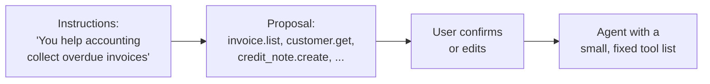
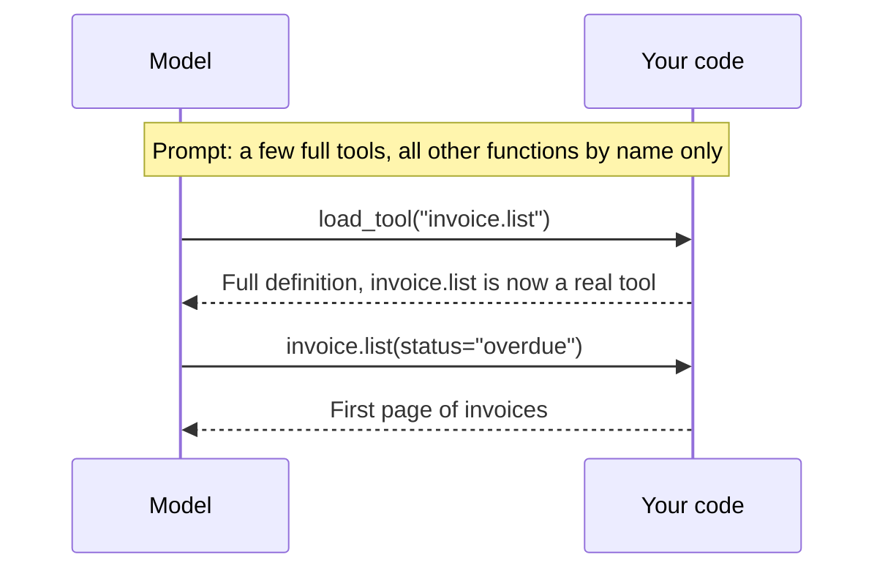
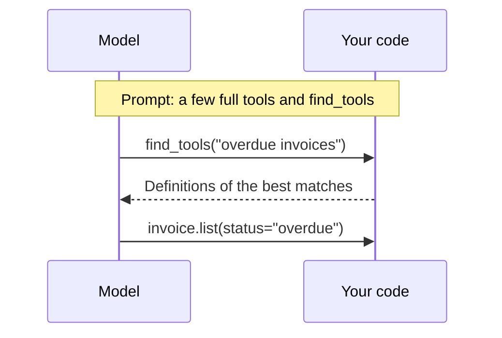
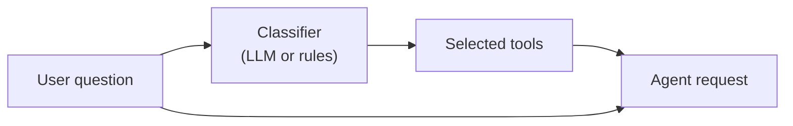
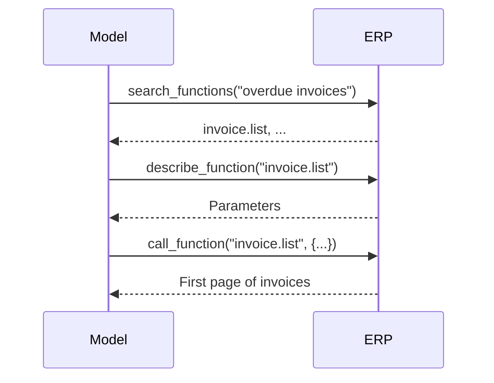
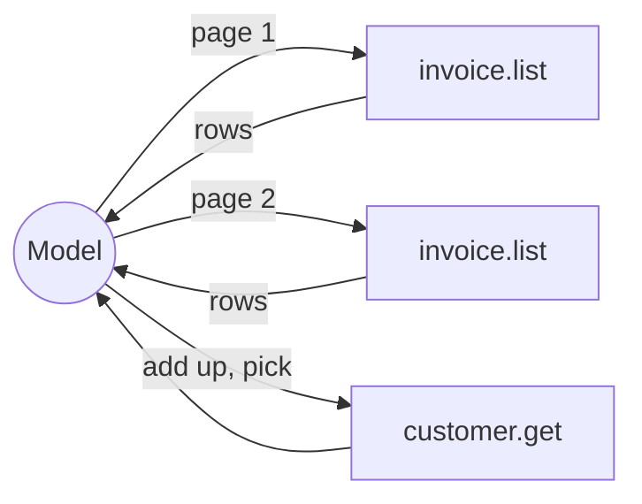
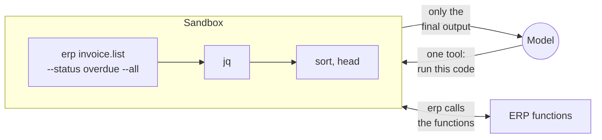

# Designing function tools

Case study: an ERP vendor opens its system to agents

<div class="small">Session 1, part 3</div>

<!--
This part is about concepts. The two code examples only show how two of the approaches look technically.
-->

---

# What part 1 means for tool design

In part 1 you followed one function call down to plain text. Three facts from there drive every design decision in this part.

| What you saw in part 1 | What it means for tool design |
|---|---|
| A tool definition is text in the prompt. | The model reads every definition in every request. Each one you add also gives the model one more option to confuse with the others. |
| A function call is text the model writes. | The model picks a function by what the names and descriptions say. Vague descriptions produce wrong calls. |
| A tool result is text in the conversation. | Everything you return stays in the context for the rest of the conversation. |

<div class="box">

### Two questions for the rest of this part

How does the model learn about a function at the moment it needs it? And what do we send back, so that the next step works and the context stays small?

</div>

<!--
Keep this short. Participants saw the raw prompt and the raw completion an hour ago. The point is to connect that picture to design decisions.
-->

---

# Start with the use case

If you know what the agent is for, build tools for that job. This is the best case, and everything later in this part is what you do when you can't have it.

<div class="columns">
<div>

### Shaped like the API

```text
invoice_read          invoice_update
customer_read         dunning_level_read
payment_list          credit_note_create
approval_create       approval_read
```

The model has to work out the workflow by itself, from the function list.

</div>
<div>

### Shaped like the use case

```text
get_overdue_summary(customer?)
request_credit_note(invoice, amount, reason)
```

The workflow is already inside the tool. The description says when to use it and when another tool is the right one.

</div>
</div>

- The tools have to fit the agent, so a collection of everything that might be useful doesn't qualify.
- Large systems get many agents per use case, each with its own instructions, tools, and skills (session 5).

<div class="box">

Use-case tools need someone who knows the use cases. The next slide is about a company that doesn't.

</div>

<!--
This is the recommendation whenever it is possible. Say it clearly so that nobody leaves with the idea that the fancy stages later are the goal.
-->

---

# Case study: an ERP vendor wants agents in its product

<div class="columns">
<div>

### The situation

- The ERP has thousands of functions across finance, sales, warehouse, and HR.
- Each tenant adds its own functions and fields.
- A role model decides who may do what.
- Business users create agents by writing instructions. Nobody expects them to go through thousands of functions.
- The vendor can't know what those agents will be used for.

</div>
<div>

### The task we follow through all stages

> Which customer has the highest total overdue amount? Please issue a credit note of 500 EUR on that customer's largest overdue invoice.

The business rule behind it is that credit notes above 200 EUR need an approval.

The task needs a list with many rows, some arithmetic, a link from invoice to customer, and a write operation that gets refused.

</div>
</div>

<div class="box">

**This company is invented.** Its requirements exist to show the design options. Nothing in this case study tells you which option fits your system.

</div>

<!--
Ask the audience who works on a product with this problem. Standard software vendors recognize it right away. Internal platforms have a smaller version of it.
-->

---

# The stages at a glance

| Stage | What the model sees in the first request | How it reaches `invoice.list` |
|---|---|---|
| **1** All tools | Every function with its full schema | It's already there. |
| **1b** Curated per agent | The functions someone chose when the agent was created | It's there if someone chose it. |
| **2** Names, details on demand | A few full tools, and only the names of the others | Recognizes the name, loads the schema, calls it |
| **2a** Tool search | A few full tools and a search tool | Searches, gets the definitions, calls it |
| **2b** Preselection | The tools a classifier picked for this question | It's there if the classifier picked it. |
| **3** Generic tools | `search_functions`, `describe_function`, `call_function` | Searches, reads the description, passes the name to `call_function` |
| **4** Code | One tool that runs code | Reads CLI help or API docs, writes code |

From stage 1 to 2b every ERP function ends up as a real tool. Stage 3 turns the function name into data. Stage 4 turns functions into commands or APIs in a language the model already knows.

<div class="box">

**The numbers are no maturity scale.** Behind them are three independent questions: how the model finds a function, how it calls it (typed tool, generic call, or code), and where intermediate data lives.

</div>

<!--
This is the map for the rest of this part. Come back to it after stage 3 and after stage 4.
-->

---

# Stage 1: attach every function as a tool

Each ERP function becomes one tool, generated from the ERP's metadata. You get the same result when you generate one MCP tool per REST endpoint.

<div class="tradeoff">
<div class="gain">

### What you gain

- It's easy to build.
- The API provider can check the arguments against each schema.
- A list that never changes is the best case for prompt caching. That lowers the price, and the context stays just as full.

</div>
<div class="cost">

### What you give up

- The prompt grows with the number of functions, in every request.
- Choosing between `invoice.list`, `invoice.search`, and `invoice.list_open` gets less reliable the more of them there are.
- Provider APIs limit how many tools fit into one request.
- Every tenant's customizing changes the list.

</div>
</div>

<div class="box">

For a small tool set this is the right answer, because it's the simplest. With thousands of functions it doesn't work, and the vendor needs a way to show the model less.

</div>

<!--
Don't calculate tokens here. The qualitative argument is enough: the cost grows with the catalog and it is paid on every request, including the ones that need two tools. Check the current tool limit of your provider if somebody asks.
-->

---

# Stage 1b: curate the tools when the agent is created

The vendor doesn't know the use cases, but the person who writes the agent's instructions does. The system reads those instructions and proposes a tool selection. That person confirms it, and it's stored with the agent.



<div class="tradeoff">
<div class="gain">

### What you gain

- You get a small, reviewed list, although it's still shaped like the API.
- The fixed list can be reviewed and tested before anyone uses the agent.

</div>
<div class="cost">

### What you give up

- It needs someone able to judge the proposal.
- An open-ended assistant has no meaningful fixed list.
- New or customized functions need another review.

</div>
</div>

<!--
This is a design-time decision. All the following stages decide at runtime. Mention that this one is easy to overlook because it isn't a clever technique.
-->

---

# Stage 2: names now, details on demand

The model gets a few important tools in full. For everything else it only sees names, and one tool loads a definition when it's needed. Coding agents such as Claude Code work this way with their deferred tools.



<div class="tradeoff">
<div class="gain">

### What you gain

- The function remains a real tool, so the provider still knows its schema.
- Prompt size per function drops to one name.

</div>
<div class="cost">

### What you give up

- The list of names still grows with the catalog.
- The model has to guess from a name.
- If you add tools to the `tools` array yourself, you change the start of the prompt and lose the prompt cache. Native tool search appends definitions at the end to avoid that.

</div>
</div>

<!--
Good moment to point at the tool you use every day. A coding agent with dozens of MCP tools loads their schemas only when it needs them.
-->

---

# Stage 2a: search for tools

Instead of a list of names, the model gets a search tool and asks for what it needs. Keyword search, embeddings, or both can sit behind it. OpenAI's Responses API has `tool_search` with `defer_loading`, hosted or with `execution: "client"`.



<div class="tradeoff">
<div class="gain">

### What you gain

- With your own search behind it, the first request no longer depends on the catalog size.
- Functions from tenant customizing are found the same way as standard ones.

</div>
<div class="cost">

### What you give up

- Everything depends on the quality of the metadata. The user says "Gutschrift", the catalog says `credit_note`.
- Every lookup is one more round trip.
- The search should only return what the user's role allows, and the call has to check it again anyway.

</div>
</div>

<!--
The vocabulary problem is real in ERP: users speak their own language and their own company's jargon, metadata is written by developers. Synonyms in the metadata help. That is what the keywords array in our example does.

Hosted tool_search works on the deferred tools you send in the request, so the catalog still travels with it. For a single deferred function the model still sees name and description, only the parameters are held back. Namespaces hide the individual functions. A tenant-specific catalog with role filtering points to client execution, which is what this diagram shows.
-->

---

# Stage 2b: preselect tools for each question

Before the agent's first request, a classifier looks at the user's question and picks the tools. The model doesn't need to search because the tools are already there. Step 7 had a small version of this decision. With thousands of tools the classifier picks a domain or a tool group, or chooses from candidates a search returned.



<div class="tradeoff">
<div class="gain">

### What you gain

- The agent needs no extra round trips for discovery.
- A small, fast model can often do the classification.

</div>
<div class="cost">

### What you give up

- If the classifier misses a tool, the model doesn't know the tool exists.
- Conversations change topic after the first question, so a one-time selection gets stale.
- A tool list that differs per question gets little from the prompt cache.

</div>
</div>

<div class="box">

A missed tool stays invisible to the model, so stage 2b works best with stage 2a behind it as a fallback.

</div>

<!--
Combine with 2a so that the model can recover when the classifier was wrong. The confidence threshold from step 7 fits here: low confidence falls back to search.
-->

---

# Stage 3: generic tools for search and call

Same idea as stage 2, but the ERP functions stop being tools. The model has three fixed tools, and the name of an ERP function is just an argument.

<div class="columns">
<div>



</div>
<div>

### You know this pattern already

| Domain | Per-item tools | Enumerable and generic |
|---|---|---|
| Database | One tool per stored procedure | List procs, exec proc, or execute SQL |
| REST API | One tool per endpoint | OpenAPI spec, generic request tool |
| ERP | One tool per function | Search, describe, call |

The call itself can follow something like JSON-RPC: a method name and parameters.

</div>
</div>

<!--
This is the move from "the catalog is a list of tools" to "the catalog is data the model can query". Standard software vendors often end up here, because it works with any client.
-->

---

# Stage 2 and stage 3 side by side

| | Stage 2, 2a, 2b | Stage 3 |
|---|---|---|
| **Tool list during a conversation** | Grows or changes | Stays the same |
| **Who can check the arguments** | The provider in strict mode, and your server | Only your server, so error messages carry the correction |
| **Round trips before the first real call** | None or one, as the tool may already be there | Search, describe, then call |
| **What the client has to do** | Add tools at runtime, unless the API's tool search does it | Nothing special, so it works in any MCP client (session 2) |
| **What an approval dialog sees** | A tool named `credit_note.create` | A tool named `call_function`, the real function is inside the arguments |

<div class="box">

Neither column wins. For the model both are text, as you saw in part 1. The difference is where the text sits and what the provider and the client can do with it. Stage 3 gives up those things and in return works unchanged with any client.

</div>

<!--
The third row matters for a vendor who doesn't control the client. The fourth row prepares the control slide.
-->

---

# Demo: stage 3 in code

The ERP in the example has four functions and a few rows in memory. The model only ever gets these three tools:

```ts
search_functions:  ({ query })      => searchFunctions(query),
describe_function: ({ name })       => describeFunction(name),
call_function:     ({ name, args }) => callFunction(name, args),
```

`call_function` can't use a strict schema, because `args` differs per function. So the ERP checks the arguments itself:

```ts
const missing = fn.parameters.required.filter((key) => args[key] === undefined);
const unknown = Object.keys(args).filter((key) => !(key in fn.parameters.properties));
if (missing.length > 0 || unknown.length > 0) {
  return { error: "Missing arguments: ... Unknown arguments: ...", parameters: fn.parameters };
}
```

```bash
npm run 09:generic
```

### What to watch in the output

- The order of search, describe, and call, which comes from the tool descriptions.
- How many pages of invoices go through the model.
- What the model does when `credit_note.create` refuses the amount.

<!--
The code is in 09-generic-tools/main.ts and shared/erp.ts. Runs differ, the model sometimes describes several functions up front. Don't present a run as a measurement.
-->

---

# What stages 1 to 3 can't do on their own

In every stage so far, each result passes through the model. For our task the model reads each page of invoices, adds the amounts itself, and copies the ids into the next call.



All the rows stay in the context, and the sum is computed by a language model. A function that aggregates on the server avoids this, but only for the questions someone built it for.

<div class="box">

### One way out: Programmatic Tool Calling (step 8)

The model writes a small program that calls your tools, and only the program's result comes back. The program has to know the shape of each result in advance, which is why step 8 used an `output_schema`. A generic `call_function` returns something different per function, so at stage 3 that information would have to come from `describe_function`.

A subagent is another way out. The supervisor only gets its final text, not its tool calls (step 6).

</div>

<!--
This is the third question from the map: where intermediate data lives. Stages 1 to 3 can get it through a mechanism like Programmatic Tool Calling. Stage 4 has it built in.
-->

---

# Stage 4: code in a language the model knows

Same catalog as stage 3, but the functions are exposed as an API or as CLI commands. The model writes Python, TypeScript, or Bash, and that code runs in a sandbox.



<div class="tradeoff">
<div class="gain">

### What you gain

- Composition is built in, through pipes, loops, and variables.
- Intermediate data stays out of the context.
- The model already knows the language. It finds the rest through `--help` or type definitions.

</div>
<div class="cost">

### What you give up

- You have to run generated code safely.
- Before it runs, you only see a script. Single calls are visible only inside the `erp` command.
- The model has to debug its own failed scripts, and nothing checks arguments before the call.
- A loop with a write command does a lot of damage in one tool call.

</div>
</div>

<!--
Stages 3 and 4 share the discovery idea. The difference is the form of the call: a JSON document against code in a real language.
-->

---

# just-bash: a Bash for your agent, without a machine

[just-bash](https://github.com/vercel-labs/just-bash) is a Bash interpreter written in TypeScript. It runs inside your Node process, with an in-memory file system and with `jq`, `grep`, `awk`, and `sort` included. It has no network access unless you turn it on.

```ts
import { Bash, defineCommand } from "just-bash";

const erp = defineCommand("erp", async (argv) => {
  const [subcommand, ...rest] = argv;
  // Look up the function, call it, return its result as text.
  return { stdout: "...\n", stderr: "", exitCode: 0 };
});

const bash = new Bash({ customCommands: [erp] });
const { stdout, stderr, exitCode } = await bash.exec("erp invoice.list --all | jq ...");
```

- `defineCommand` registers one command `erp`, and the catalog becomes its subcommands. You don't need one command per function.
- Your command is ordinary TypeScript in the host process. The simulated shell limits what the generated script can do, and your command decides what it does for that script.
- Python and JavaScript are opt-in. Arbitrary binaries need a container or a microVM.
- The project calls itself beta software, and it runs without VM isolation.

<!--
The erp command is host code, so just-bash's limits can't stop an endless loop inside it. Most participants won't know just-bash. Emphasize that it simulates a shell, which makes it light and also limits what can run in it.
-->

---

# Demo: stage 4 in code

First without an LLM, so you can see that these are ordinary shell commands:

```bash
npm run 10:bash
```

```bash
erp search credit
erp invoice.list --help
erp invoice.list --status overdue --all \
  | jq -r '.items | group_by(.customer_id)
           | map({customer: .[0].customer_id, total: (map(.amount) | add)})
           | sort_by(-.total) | .[] | "\(.customer) \(.total)"'
```

```text
C-1 4900
C-3 4200
C-2 3350
```

Then the same `erp` command as the only tool of an agent:

```bash
npm run 10:agent
```

### What to watch in the output

- `--all` follows the cursors inside the command. The pages don't go through the model.
- Whether the model writes a pipeline or reads everything, because that's up to the model.

<!--
10-bash-tools/try-bash.ts is the version without an LLM, main.ts is the agent. Some runs use jq, others call erp with --all and read the JSON. Show what actually happens.
-->

---

# For all stages: names, descriptions, parameters

Most agents have a handful of tools, and this is what decides whether the model uses them well. At stages 3 and 4 the same text comes back from `describe_function` or `--help`.

<div class="columns">
<div>

### Before

```ts
{
  name: "process_doc",
  description: "Processes a document.",
  parameters: { data: "object", mode: "string" },
}
```

### After

```ts
{
  name: "credit_note_create",
  description: "Create a credit note for one invoice. " +
    "Above 200 EUR use credit_note_request_approval.",
  parameters: {
    invoice_id: "string, for example R-15",
    amount_eur: "number greater than 0",
    reason: "goodwill | pricing_error | return",
    idempotency_key: "string, reuse it on a retry",
  },
}
```

</div>
<div>

- Say when to use the tool and when another one is right. The model picks from this text.
- Use enums wherever the values are known, because free text invites invented values.
- Keep parameters flat and the required ones few.
- Ask for IDs the model can get from an earlier result, and offer a lookup for the rest.
- Put units and formats where the model reads them, such as `amount_eur` or an ISO date.
- Make writes safe to repeat. Models retry after timeouts and errors, so a key has to prevent a second credit note.

</div>
</div>

<!--
Most participants will build a few dozen tools at most, so this is the slide they can use on Monday. The example is pseudo-schema to keep it short. Real JSON Schema uses enum, minimum, and description fields.
-->

---

# For all stages: paging

Tool results land in the context, and they stay there. A list function without limits is the fastest way to fill it.

<div class="columns">
<div>

```json
{
  "items": [ "... 3 invoices ..." ],
  "page": {
    "total": 7,
    "next_cursor": "3"
  }
}
```

```text
[Output cut at 4000 characters.
 Filter with jq or head.]
```

</div>
<div>

- Use a small default page size and enforce a maximum. A model asks for `limit: 100` if you let it.
- Say what's missing: `20 of 1843, cursor="abc"`.
- Silent truncation is the worst case, because the model then answers as if it had seen everything.
- Offer filters and field selection first. Paging is the second-best way to reduce data.
- Inside a program or a pipeline, paging can run without touching the context. That's what `--all` does.

</div>
</div>

<!--
Point back at the demo: the first page has a total and a cursor. The cap in shared/erp.ts is one line. Without it the model happily asks for everything.
-->

---

# For all stages: errors and links name the next step

<div class="columns">
<div>

### An error message is a prompt

```json
{
  "error": "Credit notes above 200 EUR need an approval.",
  "next_step": {
    "function": "credit_note.request_approval",
    "args": { "invoice_id": "R-15", "amount": 500 }
  }
}
```

A bare `403 Forbidden` leaves the model guessing. It'll retry, try another function, or give up.

</div>
<div>

### Results link to what comes next

```json
{
  "id": "R-15",
  "customer_id": "C-1",
  "links": {
    "customer": { "function": "customer.get",
                  "args": { "id": "C-1" } }
  }
}
```

This is the idea of hypermedia links in REST responses. It suits LLMs well, because the model reads the response at runtime and can act on the link right away.

</div>
</div>

<div class="box">

**Write links in the form the model can use.** With a generic request tool that's a real URL. At stage 3 it's the function and its arguments. At stage 4 it's a command line, such as `erp credit_note.request_approval --invoice_id R-15 --amount 500`.

</div>

<!--
Show the two forms in the code: erp.ts returns a structured link, erp-command.ts turns every link into a command line. At stages 1b and 2b the named function may not be available to the model, and at 2 and 2a it may have to be loaded first. A next_step that proposes a write is a suggestion, so the agent still needs a rule for who decides.
-->

---

# Control: enforce permissions below the model

Instructions and tool descriptions are requests to the model, and a model can ignore them. Rules that have to hold go into code that runs after the model is done.

| Stage | What your code sees before something runs | Where a check can sit |
|---|---|---|
| 1, 1b, 2, 2a, 2b | A tool named `credit_note.create` with arguments | Per tool in the agent loop, and in the ERP |
| 3 | `call_function` with a name inside the arguments | In the generic tool, and in the ERP |
| 4 | A script | In the `erp` command or API, and in the ERP |

- **A sandbox protects the host.** It doesn't protect ERP data, because a loop of write commands runs with the rights of the user.
- Permissions, limits, approvals, and audit logs belong to the ERP functions. In the example, the 200 EUR limit is inside `credit_note.create`, so it's the same in both demos.
- The agent acts for a user, so it needs at most that user's rights and no broader service account. OAuth for MCP and other security concepts follow in session 4.
- Every tool result is text the model reads, including customer names and invoice texts that someone else wrote. The 200 EUR limit has to hold even if such a text tells the model to ignore it.

<!--
The 200 EUR limit is per call. A for loop with three calls of 200 EUR passes it three times, so real limits need cumulative state in the ERP. This slide links the design question to security. A generic tool doesn't remove authorization, it moves the place where you can implement it. OAuth scopes per tool get coarse when there is only one tool.
-->

---

# Real systems mix the stages

The stages are options you can combine, so a system doesn't have to pick exactly one.

A coding agent shows the mix:

- It has dedicated tools for reading and editing files. These are frequent, and they benefit from approvals and precise diffs.
- It has a Bash tool for the long tail of everything else.
- It loads MCP tools on demand (stage 2).

For the ERP vendor a mix could look like curated use-case tools for agents with a known job, a generic catalog for the rest, and code execution for evaluations that only read data. Whether that's right depends on the actual customers and functions of that vendor.

Grouping functions by domain helps at every stage, because the model chooses from shorter lists. OpenAI's tool search guide suggests namespaces with fewer than about 10 functions each.

<div class="box">

Good results (paging, errors, links) and enforcement below the model are needed in every combination.

</div>

<!--
Don't turn this into a recommendation for the vendor. The point is that the stages aren't exclusive.
-->

---

# Which stage fits your project?

<div class="columns">
<div>

### Questions to answer first

- Who knows the use cases, you or your customers?
- How many functions are there really, and how similar are they to each other?
- Do agents mostly read or do they also write?
- What has to be approved and audited per action?
- Can you run generated code safely?
- Which clients have to work, only yours or any MCP client?

</div>
<div>

### Plan and measure on your own system

We didn't measure this case study, on purpose. Its requirements are invented, so numbers from it would only look precise.

In your project, take real tasks and real functions, and check:

- Does the model find the right function?
- Does it finish the task correctly?
- What does a task cost, in requests, tokens, and time?

Repeat that when the model or the catalog changes.

</div>
</div>

<div class="box">

**Next, in session 2:** the Model Context Protocol, which is how tools like these reach other clients.

</div>

<!--
This is the message participants should take home: there's a set of options and criteria, and the choice needs project-specific planning and measurement.
-->
